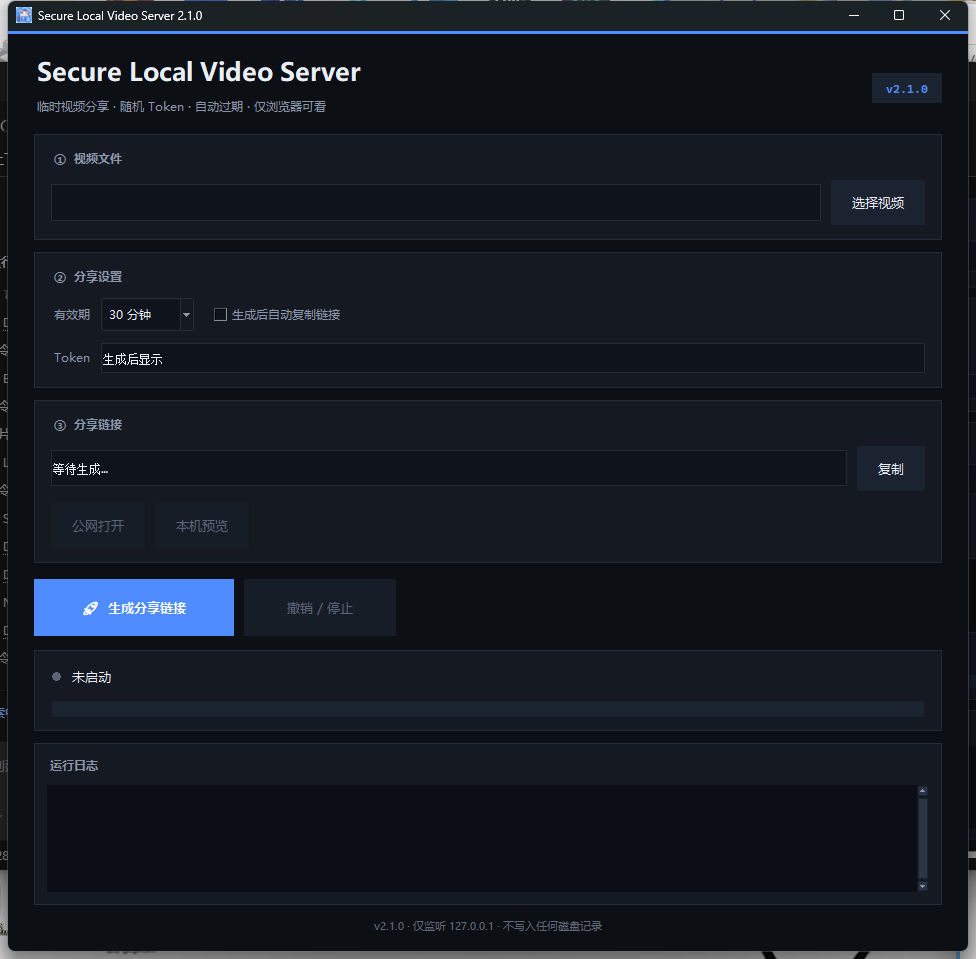
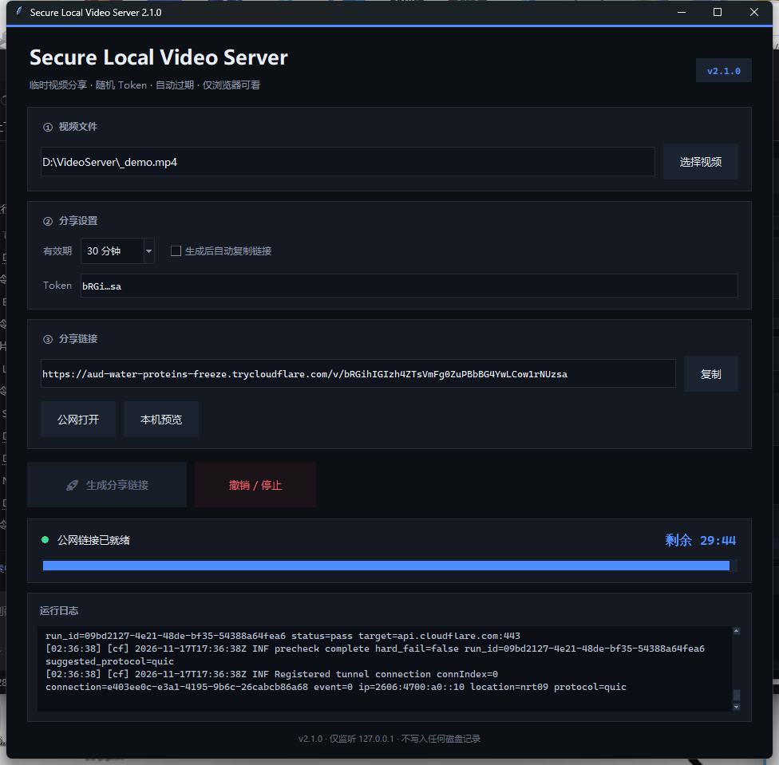

# Secure Local Video Server

一个用于将本地视频临时分享给其他用户进行在线播放的个人开源工具。

本软件适合朋友之间进行临时视频分享。用户可以选择本地视频，并通过网络生成访问地址，使其他用户能够使用浏览器访问并在线播放。

当前版本：**2.1.0**

> **注意：本软件主要用于临时在线播放分享，不保证视频绝对无法被保存、缓存、复制或通过其他方式获取。请勿将本软件用于分享违法、侵权或未经授权的内容。**

---

## 功能

* 本地视频在线播放
* 临时网络分享，链接会过期、可随时撤销
* 浏览器访问，无需安装播放器
* 支持文件拖拽
* 分享链接生成
* 可配合 Cloudflare Tunnel 使用
* Windows 图形化操作界面
* 无需每次通过命令行启动

---

## 2.1.0 的安全机制

2.1.0 在 2.0.0 的基础上重写了链接与会话逻辑，目标是「能看、不能拿」。

* **会话化访问**：打开分享页面时会校验链接 token，通过后才下发会话 Cookie；之后播放地址必须同时匹配 Cookie、UA 指纹与 Referer，单靠复制视频地址打不开。
* **不落盘**：链接 token、会话、过期时间全部保存在内存，程序退出即消失。
* **防下载**：拦截 curl、wget、yt-dlp、ffmpeg、IDM 等常见下载工具的 UA；页面屏蔽右键、拖拽与 `Ctrl+S`，播放器去掉下载按钮。
* **走动水印**：播放页面每 9 秒移动一次水印，显示会话 ID 前 10 位，录屏可追溯。
* **防索引**：`/` 与 `/robots.txt` 返回 404，响应头带 `X-Robots-Tag: noindex`，页面 CSP 为 `default-src 'none'`。
* **自动失效**：有效期可在 5 分钟 ~ 24 小时之间选择（默认 30 分钟），到期页面停止播放并自动关闭隧道；单会话限速 180 次/分钟，同时最多 6 个会话（超出时挤掉最早的一个）。
* **就近端口**：服务监听 `127.0.0.1` 上的系统随机空闲端口，不再固定 8000，重启不会被占用。

---

## 软件界面

软件启动后可以通过图形化界面进行相关操作。

用户无需手动输入复杂的命令即可启动视频服务器以及进行视频分享。

**未启动：**



**分享中：**



---

## 使用方法

### 1. 启动软件

运行：

```text
SecureLocalVideoServer.exe
```

启动软件后，点击「选择视频」挑选需要分享的文件。

### 2. 选择视频

可以通过文件选择功能选择本地视频，部分操作支持直接将视频文件拖拽到软件窗口。

### 3. 生成分享链接

点击「生成分享链接」后，软件会启动本地服务并建立 Cloudflare Tunnel，
生成形如 `https://xxx.trycloudflare.com/v/...` 的外部访问地址。

> 新生成的域名可能需要几秒到十几秒才可被解析，刚拿到链接时打不开属正常现象。

### 4. 分享链接

将生成的访问地址发送给需要观看视频的朋友即可。

对方打开后即可在浏览器里播放；链接过期或被「撤销」后立即失效。

请注意：

**获得链接的人可能能够访问对应的视频内容。**

因此，请不要将私人视频或敏感内容的链接公开发布。

---

## Cloudflare Tunnel

本软件可以配合 Cloudflare Tunnel / `cloudflared` 使用。

`cloudflared` 是 Cloudflare 提供的官方程序，本项目本身并不包含 Cloudflare 的服务。

如果需要使用相关功能，请从 Cloudflare 官方渠道获取对应版本的 `cloudflared`。

请遵守 Cloudflare 的服务条款以及相关法律法规。

---

## 下载

正式版本请前往 GitHub 的 **Releases** 页面获取。

推荐普通用户下载 Release 中提供的：

```text
SecureLocalVideoServer_Setup_V2.1.0.exe
```

源码用户可以直接下载本项目源代码。

---

## 系统要求

目前主要针对：

* Windows 10
* Windows 11
* x64

建议使用较新的 Windows 系统和现代浏览器。

---

## 开发环境

本项目主要使用：

* Python 3.10
* Tkinter
* Flask
* PyInstaller
* Inno Setup
* Cloudflare Tunnel / cloudflared

具体依赖请参阅：

```text
requirements.txt
```

---

## 从源码运行

安装 Python 3.10 后，在项目目录运行：

```bash
py -3.10 -m pip install -r requirements.txt
```

将 `cloudflared.exe` 放到项目根目录（下载地址见下），然后运行：

```bash
py -3.10 server_gui_v2.py
```

`cloudflared.exe` 体积约 55 MB，未纳入仓库，请从
<https://github.com/cloudflare/cloudflared/releases> 下载 Windows amd64 版本。

---

## 从源码打包

双击 `build.bat`，或在命令行运行：

```bat
build.bat
```

生成的文件位于：

```text
dist\SecureLocalVideoServer\
```

再生成安装包（需要 Inno Setup 6）：

```bat
"C:\Program Files (x86)\Inno Setup 6\ISCC.exe" VideoLinkServer.iss
```

安装包输出到 `installer_output\`。

---

## 测试

```bat
py -3.10 tests\test_server.py     :: 单元测试
py -3.10 tests\smoke_http.py      :: 真实 socket 冒烟测试
py -3.10 tests\smoke_tunnel.py    :: 端到端测试（含真实 Cloudflare 隧道）
```

---

## 项目结构

```text
SecureLocalVideoServer/
│
├─ server_gui_v2.py
├─ build.bat
├─ version_info.txt
├─ VideoLinkServer.iss
├─ SecureLocalVideoServer.ico
├─ README.md
├─ CHANGELOG.md
├─ LICENSE
├─ requirements.txt
├─ .gitignore
├─ 用户须知与免责声明.md
│
├─ assets/
│   └─ ...
│
└─ tests/
    ├─ test_server.py
    ├─ smoke_http.py
    ├─ smoke_tunnel.py
    └─ ...
```

---

## 用户须知与免责声明

使用本软件即表示用户理解并接受相关使用风险。

本软件为个人开发的开源软件。

用户使用本软件向他人分享视频或其他内容时，应自行确认相关内容具有合法的使用权、传播权或其他必要授权。

因用户自身行为、违规使用、分享非法或未经授权内容、第三方网络服务、网络环境、设备故障等原因产生的责任，由相应责任方承担。

软件作者在法律允许的范围内不对用户使用本软件产生的直接或间接损失承担责任。

本软件无法保证第三方设备、浏览器或网络环境绝对无法保存、缓存、复制或获取视频内容。

详细内容请查看：

```text
用户须知与免责声明.md
```

---

## Bug / 问题反馈

如果发现：

* Bug
* 异常行为
* 安全问题
* 滥用行为
* 盗取行为
* 欺诈行为

请联系作者。

**Email：**

[xinyuwang668@gmail.com](mailto:xinyuwang668@gmail.com)

反馈 Bug 时，如果条件允许，请提供：

1. Windows 版本
2. 软件版本
3. 操作步骤
4. 错误信息
5. 截图

---

## 开源协议

本项目采用 MIT License。

详细内容请查看：

```text
LICENSE
```

---

## 作者

**xinyuwang668**

Email:

[xinyuwang668@gmail.com](mailto:xinyuwang668@gmail.com)

---

## Disclaimer

This software is provided for personal and legitimate use.

The developer is not responsible for illegal, unauthorized, infringing, abusive, fraudulent, or otherwise improper use of this software.

Users are responsible for the content they share and for complying with applicable laws and third-party service terms.
